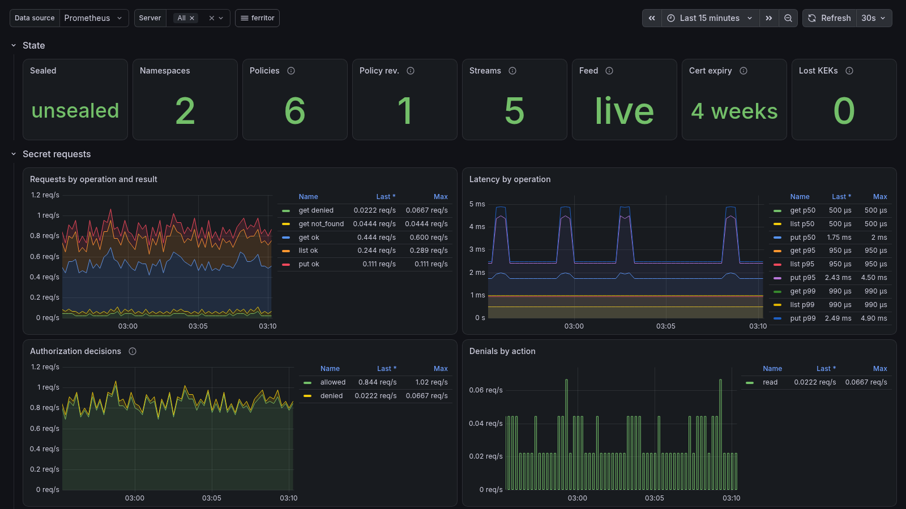
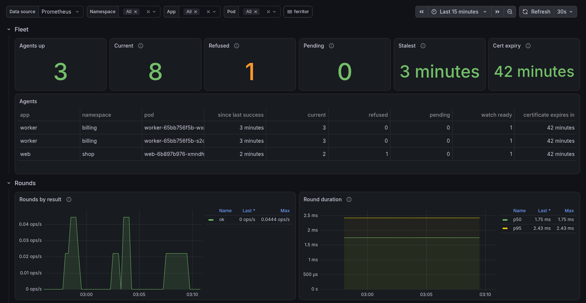
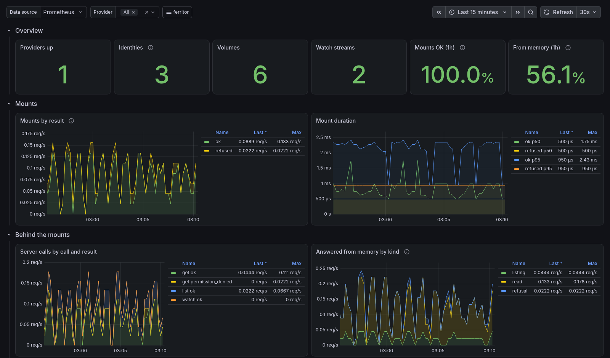

All three binaries, the server, [the agent](/guides/agent) and [the CSI
provider](/guides/csi), report metrics the same way: OpenTelemetry
instruments, pushed over OTLP or scraped by Prometheus, chosen by their
config's `[metrics]` section and read at startup. Attributes are small
fixed sets (an operation, a result, a reason): never a secret's path, an
identity, a pod, a file name or a value.

## Choosing an exporter

`[metrics] exporter` is one of:

- **`otlp`**: pushed over OTLP/gRPC to the collector
  `OTEL_EXPORTER_OTLP_ENDPOINT` (or `OTEL_EXPORTER_OTLP_METRICS_ENDPOINT`)
  names; without it, the binary refuses to start. The other standard
  variables apply: `OTEL_METRIC_EXPORT_INTERVAL` (default 60 s),
  `OTEL_RESOURCE_ATTRIBUTES`, and `OTEL_SERVICE_NAME` (default the
  binary's name, `ferritor-server`, `ferritor-agent` or
  `ferritor-csi-provider`). `https://` (or no scheme, unless
  `OTEL_EXPORTER_OTLP_INSECURE=true`) is TLS with the public roots, plus
  `OTEL_EXPORTER_OTLP_CERTIFICATE` for a private CA and
  `OTEL_EXPORTER_OTLP_CLIENT_CERTIFICATE`/`_CLIENT_KEY` for mTLS; `http://`
  is plaintext, for a collector on the same host. The last export is
  flushed at exit.
- **`prometheus`**: `GET /metrics` in the text format, on a listener of
  its own (`listen_addr`), never a binary's main one. The `OTEL_*`
  variables are ignored then (a set endpoint warns).
- **`none`**: off.

Without `exporter`, it's OTLP if `OTEL_EXPORTER_OTLP_METRICS_ENDPOINT` or
`OTEL_EXPORTER_OTLP_ENDPOINT` is set (and not empty), off if neither is.
One exporter at a time.

The Prometheus listener, per binary:

| | Default `listen_addr` | Off loopback |
|---|---|---|
| Server | `127.0.0.1:9464` | TLS with the server's certificate (secured mode; renewed with it on SIGHUP), with `client_ca` a scraper must present a certificate from that CA; plaintext only with `tls = false` |
| Agent | `127.0.0.1:9465` | plaintext only, with `tls = false` said (it has no certificate to serve with) |
| CSI provider | `127.0.0.1:9466` | the same as the agent's |

On a loopback address the listener is plaintext and answers only requests
addressed to loopback (`localhost` or a loopback IP), against DNS
rebinding: a web page that gets its own name resolved to `127.0.0.1` is
refused (421). Plaintext off loopback warns at startup. The server's
answers while sealed too, and a scrape is no request there: no audit entry,
no rate limit, not counted in `ferritor.in_flight`. Settings:
[server](/reference/configuration#metrics), [agent](/guides/agent#configuration),
[CSI provider](/guides/csi#running-it).

```toml
[metrics]
exporter = "prometheus"
listen_addr = "127.0.0.1:9464"
```

```sh
curl -s http://127.0.0.1:9464/metrics | grep ferritor_sealed
```

Names follow OpenTelemetry's Prometheus conventions: dots become
underscores, a unit adds its suffix (`_seconds`), a counter ends in
`_total`, and a histogram is its `_bucket`, `_sum` and `_count` series. The
tables below give both names; tests hold each to what a scrape returns.
Request durations are bucketed from 1 ms to 10 s.

## The server

The server's wait for a slot under the server-wide cap is bucketed from 0
to 10 s.

| Instrument | Prometheus | Kind | Attributes |
|---|---|---|---|
| `ferritor.secret.requests` | `ferritor_secret_requests_total` | counter | `operation`, `result` |
| `ferritor.secret.request.duration` | `ferritor_secret_request_duration_seconds` | histogram (s) | `operation`, `result` |
| `ferritor.admin.outcomes` | `ferritor_admin_outcomes_total` | counter | `operation`, `result` (succeeded, failed, unknown) |
| `ferritor.authorization.decisions` | `ferritor_authorization_decisions_total` | counter | `action`, `decision` (allowed, denied, sealed, unverified) |
| `ferritor.audit.failures` | `ferritor_audit_failures_total` | counter | `kind` (refused, lost) |
| `ferritor.versions.trimmed` | `ferritor_versions_trimmed_total` | counter | |
| `ferritor.versions.purged` | `ferritor_versions_purged_total` | counter | |
| `ferritor.deks.rewrapped` | `ferritor_deks_rewrapped_total` | counter | |
| `ferritor.tls.handshake.failures` | `ferritor_tls_handshake_failures_total` | counter | `listener` (api, exchange, metrics: a scraper without the right certificate counts here, not as an API client), `reason` (failed, timed_out) |
| `ferritor.rate_limit.refused` | `ferritor_rate_limit_refused_total` | counter | `limit` (rate, in_flight, denied, unauthenticated; exchanges: a token exchange refused, too many for its identity; exchange_refused: a refused exchange's audit entry left out; server: no slot under the server-wide cap in time) |
| `ferritor.identity.exchanges` | `ferritor_identity_exchanges_total` | counter | `issuer` (a configured issuer's name, or unknown), `result` (issued, refused, unavailable, rate_limited) |
| `ferritor.rate_limit.waited` | `ferritor_rate_limit_waited_seconds` | histogram (s) | the wait for a slot under the server-wide cap |
| `ferritor.reloads` | `ferritor_reloads_total` | counter | `kind` (policy, certificate, crl, keyring, policy_store, identity), `result` (policy_store: changed, unchanged, failed, integrity, rollback, recovered; counted on every attempt, while a failure is logged and audited only when it starts, changes or ends) |
| `ferritor.policy.revision` | `ferritor_policy_revision` | gauge | the stored policies' verified revision in force; absent unless one is |
| `ferritor.policies` | `ferritor_policies` | gauge | stored policies in force; absent unless verified |
| `ferritor.audit.queue.depth` | `ferritor_audit_queue_depth` | gauge | entries waiting for the writer |
| `ferritor.in_flight` | `ferritor_in_flight` | gauge | calls in flight, every one (exempt admin calls too, which the server-wide cap doesn't count) |
| `ferritor.sealed` | `ferritor_sealed` | gauge | 1 sealed, 0 unsealed |
| `ferritor.namespaces` | `ferritor_namespaces` | gauge | namespaces this server holds KEKs of; absent while sealed (a count, never names) |
| `ferritor.seal.auto_unseal` | `ferritor_seal_auto_unseal_total` | counter | `result`: ok, kms_unavailable, denied, mismatch, root_commitment, below_floor, no_wrap, held, failed (see [key management](/operations/key-management#auto-unseal)) |
| `ferritor.seal.hold_pending` | `ferritor_seal_hold_pending` | gauge | auto-unseal hold (or release) writes being retried after a seal; 0 normally |
| `ferritor.seal.floor_pending` | `ferritor_seal_floor_pending` | gauge | root-generation floor raises being retried after an init or a rekey; 0 normally (see [key management](/operations/key-management#the-root-commitment)) |
| `ferritor.kek.vanished` | `ferritor_kek_vanished` | gauge | KEKs held for reading only because the keys database lost them; 0 normally (see [high availability](/operations/high-availability)) |
| `ferritor.server_certificate.expiry` | `ferritor_server_certificate_expiry_seconds` | gauge (unix s) | secured mode |
| `ferritor.tls.crl.next_update` | `ferritor_tls_crl_next_update_seconds` | gauge (unix s) | the earliest `nextUpdate` of the CRLs in force |
| `ferritor.watch.streams` | `ferritor_watch_streams` | gauge | [watch streams](/guides/secrets#watching) open (at most 4,096 per server) |
| `ferritor.watch.feed.live` | `ferritor_watch_feed_live` | gauge | 1 while the change feed polls the data database, 0 while it can't |
| `ferritor.watch.feed.held_back` | `ferritor_watch_feed_held_back_seconds` | gauge (s) | how long one open transaction has held the change feed back (below); 0 normally |
| `ferritor.watch.resyncs` | `ferritor_watch_resyncs_total` | counter | `reason` (too_many, restarted: every stream told at once; lagged: one stream fell behind) |

### What to alert on

- `ferritor_sealed` at 1: nothing can be read until it's unsealed.
- `ferritor_seal_hold_pending` above 0: a sealed server a restart could
  unseal again.
- `ferritor_seal_auto_unseal_total` with any result but `ok` and `held`: a
  server that can't unseal itself; `root_commitment` and `below_floor` need
  a person ([key management](/operations/key-management#auto-unseal)).
- `ferritor_kek_vanished` above 0: urgent, see [high
  availability](/operations/high-availability).
- `ferritor_audit_queue_depth` rising (stdout stalling, before requests are
  refused), and any `ferritor_audit_failures_total`.
- The two expiry gauges, `ferritor_server_certificate_expiry_seconds` and
  `ferritor_tls_crl_next_update_seconds`, getting near.
- `ferritor_policy_revision` differing between servers for longer than
  `policy_refresh_secs`: a rollback of the stored policies, one server
  still having the newer set.
- `ferritor_reloads_total` with `kind="policy_store"` and `result`
  `integrity` or `rollback`: the stored policies don't verify (see
  [policy](/guides/policy)); re-apply them from their source of truth with
  `ferritor policy apply --prune`, and find out who changed the keys
  database.
- `ferritor_watch_feed_live` at 0 for more than a few seconds: the data
  database unreachable for the change feed, so no new watch streams, and
  the agents and providers fall back to their intervals.
- `ferritor_watch_streams` near 4,096: new streams refused with
  `WATCH_FULL` (an identity's own cap, 256 by default, is
  `max_watch_streams` in [configuration](/reference/configuration)).
- `ferritor_watch_feed_held_back_seconds` above a few minutes: [a
  transaction left open](/operations/running#a-transaction-left-open).
- The rate limits: [operations](/operations/running#rate-limits).

**The process is closed to its own user.** The server marks itself
undumpable at startup (see [security](/concepts/security)), so `/proc/<pid>/`
belongs to root: a monitoring agent that reads it as an unprivileged user
(a process exporter, some APM agents) gets nothing for ferritor, and neither
do debuggers and profilers. Use the metrics above, or run such an agent as
root. There are no core dumps either: a crash leaves its panic message and
backtrace on stderr, in the journal.

## The agent

| Instrument | Prometheus | Kind | Attributes |
|---|---|---|---|
| `ferritor.agent.rounds` | `ferritor_agent_rounds_total` | counter | `result` (ok; transient: stopped by a transient refusal) |
| `ferritor.agent.round.duration` | `ferritor_agent_round_duration_seconds` | histogram (s) | `result`; the round's writes, notifications and status files included |
| `ferritor.agent.calls` | `ferritor_agent_calls_total` | counter | `call` (get, list, watch), `result` (ok, permission_denied, not_found, invalid, transient) |
| `ferritor.agent.writes` | `ferritor_agent_writes_total` | counter | `result` (ok, failed): sets of files swapped in |
| `ferritor.agent.notifications` | `ferritor_agent_notifications_total` | counter | `kind` (signal, command), `result` (ok, failed, timed_out: a command still running after 60 s). A signal counts once per process it's sent to |
| `ferritor.agent.exchanges` | `ferritor_agent_exchanges_total` | counter | `result` (ok, failed): with `token_file` |
| `ferritor.agent.watch.events` | `ferritor_agent_watch_events_total` | counter | `event` (ready, changed, resync, ended, failed) |
| `ferritor.agent.secrets` | `ferritor_agent_secrets` | gauge | `state` (current: readable, its value in its file; refused: for good, its file per `on_revoked`; pending: neither yet, not read or not written: the first set waiting for a required secret, a write that failed) |
| `ferritor.agent.last_success` | `ferritor_agent_last_success_seconds` | gauge (unix s) | when a round last succeeded; absent before the first |
| `ferritor.agent.watch.ready` | `ferritor_agent_watch_ready` | gauge | 1 while a ready stream covers every watched secret |
| `ferritor.agent.certificate.expiry` | `ferritor_agent_certificate_expiry_seconds` | gauge (unix s) | the client certificate in use: from its file, or as exchanged |

Worth an alert: `time() - ferritor_agent_last_success_seconds` past a few
intervals (the files have stopped following the server; while a watch
stream is ready rounds stretch to ten intervals, at most ten minutes, so
allow for that: 15 minutes is a fair default), any
`ferritor_agent_secrets{state="refused"}` or `{state="pending"}` that
lasts, a `ferritor_agent_certificate_expiry_seconds` near (a certificate
from files nobody renews).

## The CSI provider

| Instrument | Prometheus | Kind | Attributes |
|---|---|---|---|
| `ferritor.csi.mounts` | `ferritor_csi_mounts_total` | counter | `result` (ok, refused, failed: transient, the volume as it is; invalid: the `SecretProviderClass`) |
| `ferritor.csi.mount.duration` | `ferritor_csi_mount_duration_seconds` | histogram (s) | `result` |
| `ferritor.csi.calls` | `ferritor_csi_calls_total` | counter | `call` (get, list, watch), `result` (ok, permission_denied, not_found, invalid, transient) |
| `ferritor.csi.from_memory` | `ferritor_csi_from_memory_total` | counter | `kind` (read: shared, vouched for by a watch, or the volume's own value at the version its listing shows; listing: shared, or vouched for by a watch; refusal: remembered, backing off): answered without the server |
| `ferritor.csi.exchanges` | `ferritor_csi_exchanges_total` | counter | `result` (issued, refused, failed): pods' tokens, renewals included |
| `ferritor.csi.watch.events` | `ferritor_csi_watch_events_total` | counter | `event` (ready, changed, resync, ended, failed) |
| `ferritor.csi.identities` | `ferritor_csi_identities` | gauge | identities with a certificate on this node |
| `ferritor.csi.volumes` | `ferritor_csi_volumes` | gauge | volumes remembered |
| `ferritor.csi.watch.streams` | `ferritor_csi_watch_streams` | gauge | identities' watch streams open and ready |

Worth an alert: `ferritor_csi_mounts_total{result="failed"}` rising (pods
waiting on a server they can't reach, or a sealed one), and
`{result="refused"}` after a policy change.

## Scraping in Kubernetes

With kube-prometheus-stack (the Prometheus Operator):

- **The server** off loopback serves TLS, and only scrapers with a
  certificate from a CA of your own should read it: the scrapers' CA, the
  `ServiceMonitor` and Prometheus's certificate are in
  [Kubernetes](/getting-started/kubernetes#before-going-live).
- **Agents and providers** serve plaintext: listen on `0.0.0.0` with `tls =
  false`, name the container's port, and select the pods with a
  `PodMonitor`. Anyone who reaches the pod's port reads the metrics (counts
  and results, nothing of a value), so keep it to the cluster's network.

```toml
[metrics]
exporter = "prometheus"
listen_addr = "0.0.0.0:9465"   # the provider's: 9466
tls = false
```

```yaml
# The agent's container (a sidecar), or the provider's DaemonSet:
ports: [{name: metrics, containerPort: 9465}]
# and the pod template's labels:
labels: {app: billing-worker, ferritor-metrics: agent}   # ferritor-metrics: csi-provider
---
apiVersion: monitoring.coreos.com/v1
kind: PodMonitor
metadata:
  name: ferritor
  namespace: monitoring
  labels: {release: monitoring}   # kube-prometheus-stack's release name: it selects by it
spec:
  namespaceSelector: {any: true}
  selector:
    matchExpressions: [{key: ferritor-metrics, operator: Exists}]
  podMetricsEndpoints:
    - port: metrics
      relabelings:
        - {sourceLabels: [__meta_kubernetes_pod_label_ferritor_metrics], targetLabel: component}
        - {sourceLabels: [__meta_kubernetes_pod_label_app], targetLabel: app}
```

The `component` and `app` labels are what the dashboards below filter by.
kube-prometheus-stack picks up only the monitors labelled with its
release's name (`monitoring` here); installed with
`prometheus.prometheusSpec.podMonitorSelectorNilUsesHelmValues=false`, it
picks up every one.

## Dashboards

Three Grafana dashboards, one per binary, are in the repository's
[`deploy/grafana/`](https://github.com/ferritor/ferritor/tree/main/deploy/grafana)
(a test holds every metric they query to the tables above):

- `ferritor-server.json`: the seal state, namespaces and policies, secret
  requests by operation and result with their latency, authorization
  decisions and denials, rate limits, token exchanges, the audit queue,
  reloads and housekeeping.
- `ferritor-agent.json`: per pod, how long since its last good round, its
  secrets by state, its watch and its certificate's expiry; rounds, calls
  to the server, writes, exchanges and notifications.
- `ferritor-csi.json`: mounts by result and their latency, the calls to
  the server behind them and what memory answered instead, exchanges,
  watch streams, identities and volumes.







Each asks for its Prometheus data source when imported (Dashboards, New,
Import, upload the file), and filters by `pod`, and the agent's also by
`namespace` and `app` (the labels the `PodMonitor` above sets).
kube-prometheus-stack's Grafana loads them from ConfigMaps labelled
`grafana_dashboard: "1"`:

```sh
for d in server agent csi; do
  kubectl -n monitoring create configmap ferritor-dashboard-$d \
    --from-file=deploy/grafana/ferritor-$d.json
  kubectl -n monitoring label configmap ferritor-dashboard-$d grafana_dashboard=1
done
```
